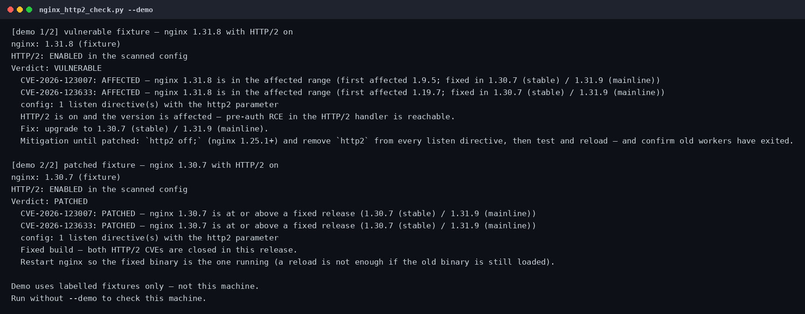

# nginx-http2-rce-check



**Answer "is my nginx exposed to the HTTP/2 RCE pair?" in 0.06 seconds — one command, zero network calls, zero dependencies.**

A stdlib-only Python CLI that checks the two things that decide whether a host is exposed to CVE-2026-123007 and CVE-2026-123633: the nginx version, and whether HTTP/2 is enabled in the config. A real check takes a median **0.062 s** (7 runs, measured 2026-11-19 on this machine) — faster than opening the advisory page. No payloads, no network scanning, no exploit code: a defensive checker only.

## Why now

On **2026-11-18**, Wiz, Ikotas Labs, Metnir, Rapid7 and Xint disclosed **two unauthenticated remote code execution flaws in nginx's HTTP/2 handling** — CVE-2026-123007 (integer underflow in HTTP/2 flow control) and CVE-2026-123633 (HTTP/2 use-after-free on proxy connections). Both are **CVSS 4.0 9.2** (CVSS 3.1 8.1); nginx.org rates 123007 "major" and 123633 "medium". The story hit **Hacker News #1 on 2026-11-19 (~1,152 points)**, and nginx powers **225M+ websites** — so the patch window is measured in hours, not weeks.

What was verified from the sources below:

- **CVE-2026-123007 is the broad one.** An integer underflow in HTTP/2 flow control, exploitable in a **default config with HTTP/2 enabled — even serving plain static files**, no backend needed. Wiz confirmed RCE with an ASLR bypass on stock **1.31.7/1.31.8** builds. First affected: **1.9.5** (2015).
- **CVE-2026-123633 is the proxy one.** A use-after-free on HTTP/2 connections, exploitable when nginx proxies to a backend **and the worker runs low on free connections** (connection pressure). First affected: **1.19.7**.
- **Both require HTTP/2 enabled** — which is not a default nginx configuration, so someone had to turn it on. Turning HTTP/2 off closes both flaws.
- **Fixed:** OSS **1.30.7 (stable) / 1.31.9 (mainline)**. NGINX Plus: 123633 fixed in **37.0.7.1 / 37.2.0.1**, 123007 fixed in **37.0.8.1 / 37.3.0.1**; **Plus R33–R36 have no fixed build** and must move to a 37.x train. (37.0.8.1 and 37.3.0.1 close both CVEs; 37.0.7.1 / 37.2.0.1 close 123633 only.)
- **No confirmed exploitation in the wild** as of the disclosures; Wiz is not releasing its exploits. Rapid7 published a PoC for 123007 (lab-tuned: ~128 GB of HTTP/2 traffic on one connection).
- **Scope note:** the 2026-11-18 release fixed ten issues, including three more RCE-related flaws (resolver, HTTP/3, mail proxy) that do **not** need HTTP/2. This checker covers only the two HTTP/2 CVEs — `http2 off` is a stopgap for these two, not a substitute for upgrading.

Sources: [Wiz write-up](https://www.wiz.io/blog/nginx-http2-rce-vulnerabilities#mitigation-and-detection-26) · [deploybase explainer](https://deploybase.io/blog/nginx-http2-rce-cve-2026-123007-123633-what-to-patch) · [IFIN advisory summary](https://ifin.network/t/cve-2026-123633-cve-2026-123007-rce-paths-in-nginx-via-http-2/1001) · nginx.org security advisories

## Quick start (30 seconds)

```bash
git clone https://github.com/Mahgal/nginx-http2-rce-check.git
cd nginx-http2-rce-check
python3 nginx_http2_check.py              # check this machine
```

No pip installs, no dependencies — Python 3 only. Try it without nginx installed:

```bash
python3 nginx_http2_check.py --demo      # labelled fixtures: 1 vulnerable, 1 patched
python3 nginx_http2_check.py --version 1.31.8 --config examples/nginx-http2-on.conf
python3 nginx_http2_check.py --version 1.30.7 --config examples/nginx-http2-on.conf
python3 nginx_http2_check.py --nginx-path examples/fake-nginx-vulnerable.sh --config examples/nginx-http2-on.conf
python3 nginx_http2_check.py --json      # machine-readable output for CI
```

Verified from a clean copy (fresh checkout in `/tmp`, 2026-11-19): `--demo` runs and the full test suite passes, 40/40, exit 0.

## Example output

Real output of `python3 nginx_http2_check.py --demo` (captured verbatim to `demo.txt`; re-runs reproduce it byte-for-byte, sha256 `e6a50babb87a98a704b802b3bbab6d5db6da256b45a45b9628ab1a930eae7f27`):

```
[demo 1/2] vulnerable fixture — nginx 1.31.8 with HTTP/2 on
nginx: 1.31.8 (fixture)
HTTP/2: ENABLED in the scanned config
Verdict: VULNERABLE
  CVE-2026-123007: AFFECTED — nginx 1.31.8 is in the affected range (first affected 1.9.5; fixed in 1.30.7 (stable) / 1.31.9 (mainline))
  CVE-2026-123633: AFFECTED — nginx 1.31.8 is in the affected range (first affected 1.19.7; fixed in 1.30.7 (stable) / 1.31.9 (mainline))
  config: 1 listen directive(s) with the http2 parameter
  HTTP/2 is on and the version is affected — pre-auth RCE in the HTTP/2 handler is reachable.
  Fix: upgrade to 1.30.7 (stable) / 1.31.9 (mainline).
  Mitigation until patched: `http2 off;` (nginx 1.25.1+) and remove `http2` from every listen directive, then test and reload — and confirm old workers have exited.

[demo 2/2] patched fixture — nginx 1.30.7 with HTTP/2 on
nginx: 1.30.7 (fixture)
HTTP/2: ENABLED in the scanned config
Verdict: PATCHED
  CVE-2026-123007: PATCHED — nginx 1.30.7 is at or above a fixed release (1.30.7 (stable) / 1.31.9 (mainline))
  CVE-2026-123633: PATCHED — nginx 1.30.7 is at or above a fixed release (1.30.7 (stable) / 1.31.9 (mainline))
  config: 1 listen directive(s) with the http2 parameter
  Fixed build — both HTTP/2 CVEs are closed in this release.
  Restart nginx so the fixed binary is the one running (a reload is not enough if the old binary is still loaded).

Demo uses labelled fixtures only — not this machine.
Run without --demo to check this machine.
```

The same cases against real flags:

```bash
$ python3 nginx_http2_check.py --version 1.31.8 --config examples/nginx-http2-on.conf
Verdict: VULNERABLE        # exit 1 — HTTP/2 on, version affected
$ python3 nginx_http2_check.py --version 1.30.7 --config examples/nginx-http2-on.conf
Verdict: PATCHED           # exit 0 — same config, fixed build
$ python3 nginx_http2_check.py --version 1.31.8 --config examples/nginx-http2-off.conf
Verdict: NOT_AFFECTED      # exit 0 — HTTP/2 off closes both flaws
$ python3 nginx_http2_check.py --version 1.24.0-0ubuntu1 --config examples/nginx-http2-on.conf
Verdict: UNKNOWN           # exit 3 — distro package: version string says nothing
```

## The branch trap

**1.30.7 is fixed, but 1.31.0–1.31.8 are still vulnerable.** A naive check — "version ≥ 1.30.7 means safe" — would call 1.31.8 safe. It is not. This tool compares against explicit per-branch ranges, never a plain numeric threshold:

| Version | CVE-2026-123007 | CVE-2026-123633 |
|---|---|---|
| < 1.9.5 | not affected | not affected |
| 1.9.5 – 1.19.6 | **affected** | not affected |
| 1.19.7 – 1.30.6 | **affected** | **affected** |
| 1.30.7 (stable fix) | patched | patched |
| 1.31.0 – 1.31.8 | **affected** | **affected** |
| 1.31.9+ / 1.32.0+ (mainline fix) | patched | patched |

## Verdicts

| Verdict | Meaning |
|---|---|
| `VULNERABLE` | Version is in an affected range **and** HTTP/2 is enabled in the scanned config. Upgrade now. |
| `PATCHED` | Version is at or above a fixed release. Restart nginx so the fixed binary is the one running. |
| `NOT_AFFECTED` | Either the version predates both flaws, or HTTP/2 is off in the scanned config. |
| `UNKNOWN` | No nginx found, the version string could not be parsed, the build is a distro package (see below), the Plus train has no published fix, or the HTTP/2 state could not be determined while the version is affected. Do not assume safe. |

## Exit codes

| Code | Meaning |
|---|---|
| `0` | `PATCHED` or `NOT_AFFECTED` |
| `1` | `VULNERABLE` — by design, so it works as a CI gate |
| `2` | Usage error (bad flag, unreadable `--nginx-path` / `--config` path) |
| `3` | `UNKNOWN` (this tool's own code — see Verdicts) |

## Affected / fixed version table

| Product | CVE-2026-123007 | CVE-2026-123633 |
|---|---|---|
| NGINX OSS | 1.9.5 – 1.31.8 | 1.19.7 – 1.31.8 |
| Fixed (OSS) | **1.30.7 stable / 1.31.9 mainline** | **1.30.7 stable / 1.31.9 mainline** |
| NGINX Plus | R33+ | R33+ |
| Fixed (Plus) | **37.0.8.1 / 37.3.0.1** | **37.0.7.1 / 37.2.0.1** |
| Plus, no fix | R33–R36 (move to a 37.x train) | R33–R36 (move to a 37.x train) |

37.0.8.1 and 37.3.0.1 close **both** CVEs; 37.0.7.1 and 37.2.0.1 close 123633 only and are still vulnerable to 123007. The 37.1 train has no published fix for either CVE and is reported `UNKNOWN`.

## The distro caveat

**A version string like `1.24.0` says nothing either way if it came from a distro package.** Debian, Ubuntu, Alpine and friends backport security fixes into old version numbers, so `nginx/1.24.0-0ubuntu1` may already be patched — or not. This tool refuses to guess: any version string carrying a package suffix (`-0ubuntu1`, `~deb12u1`, `-1`, `(Ubuntu)`) is reported `UNKNOWN` with an explanation and a pointer to your distro's CVE tracker. Check the tracker, or install the upstream build (1.30.7 / 1.31.9) and re-run.

## Mitigation until patched

- Upgrade to **1.30.7 (stable) / 1.31.9 (mainline)** — or Plus **37.0.8.1 / 37.3.0.1** — and **restart** nginx (a reload is not enough if the old binary is still loaded).
- Or disable the vulnerable path: `http2 off;` (nginx 1.25.1+) **and** remove `http2` from every `listen` directive, then test, reload, and confirm old workers have exited.
- Where an instance was reachable while unpatched, review it for signs of use and rotate its credentials if compromise cannot be ruled out.

## Tests

Stdlib `unittest` only — no pytest, no network:

```bash
python3 tests/run_tests.py
```

40 tests, all passing (exit 0), covering: every version-table boundary row (1.9.4 safe, 1.9.5 vulnerable, 1.19.6 only-123007, 1.19.7 vulnerable, 1.30.6 vulnerable, 1.30.7 fixed, 1.31.0 vulnerable, 1.31.8 vulnerable, 1.31.9 fixed, 1.32.0 fixed), the 1.30.7-vs-1.31.8 branch trap, config parsing (`http2 on` / `http2 off` / `listen ... http2` / commented-out directives / conflicting directives), distro-unknown handling (Ubuntu, Debian, bare `-1` suffixes), the full NGINX Plus table (R32 safe, R33–R36 no fix, 37.0.7.1 fixes 123633 only, 37.0.8.1 and 37.3.0.1 fix both, 37.2.0.1 fixes 123633 only, 37.1 train unknown, R37 without a build number unknown), malformed version strings, missing nginx, demo determinism (two runs byte-identical), and CLI end-to-end runs with the fixture nginx binaries and example configs.

## Scope and honesty

- Defensive checker only. This repo contains **no exploit code, no payloads, and no network scanning** — it reads `nginx -v` output and your config files and nothing else.
- It checks the version and HTTP/2 gates. It cannot prove a server is safe: HTTP/2 being off closes these two CVEs only — the 2026-11-18 release fixed other flaws that do not need HTTP/2.
- A distro package version is honestly reported `UNKNOWN` instead of guessed safe or unsafe.
- Conflicting `http2 on` / `http2 off` directives across server blocks are honestly reported `UNKNOWN` — this tool does not guess which block wins.
- The `--demo` output uses labelled fixtures, not this machine, and says so in its own output.
- Version data is as published 2026-11-18/19. If F5 publishes a new Plus fix (e.g. for the 37.1 or 37.2 train), the table in `nginx_http2_check.py` needs updating — check the F5 advisories.
